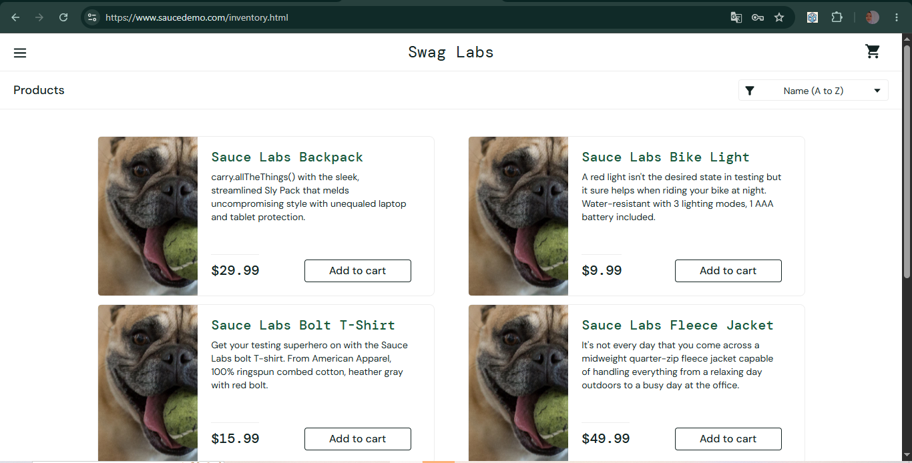

# BUG-001: Gambar produk di halaman Products tidak sesuai dengan produknya

| Keterangan | Detail |
|---|---|
| Aplikasi | SauceDemo (saucedemo.com) |
| Akun | problem_user |
| Environment | Chrome 155, Windows 10 |
| Severity | Medium |
| Status | Open |

## Kondisi Awal
Data situs sudah dihapus. Setelah login, ikon keranjang tidak menunjukkan angka.

## Langkah Reproduksi
1. Buka saucedemo.com
2. Login sebagai problem_user (password: secret_sauce)
3. Perhatikan gambar produk di halaman Products

## Expected Result
Setiap produk menampilkan gambar yang sesuai dengan nama dan keterangannya (misalnya Sauce Labs Backpack menampilkan foto tas).

## Actual Result
Keenam produk menampilkan gambar yang sama, yaitu foto seekor anjing, sehingga gambar tidak sesuai dengan nama dan keterangan produk.

## Pembanding
Dengan akun standard_user, setiap produk menampilkan gambar yang sesuai dengan namanya.

## Lampiran
**problem_user: keenam produk menampilkan foto anjing yang sama**

**standard_user (pembanding): setiap produk menampilkan gambar yang sesuai**

