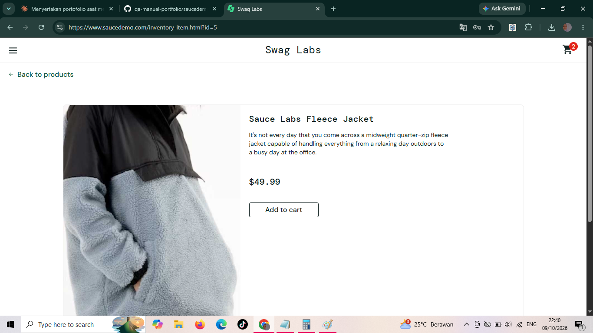
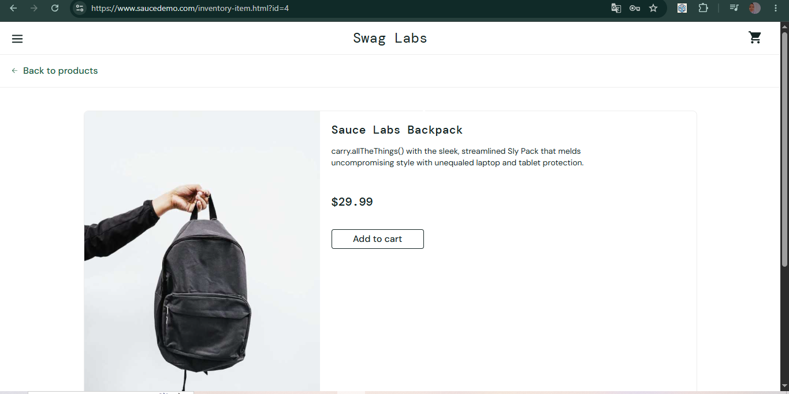

# BUG-002: Nama dan gambar di halaman detail tidak sama dengan produk yang diklik

| Keterangan | Detail |
|---|---|
| Aplikasi | SauceDemo (saucedemo.com) |
| Akun | problem_user |
| Environment | Chrome, Windows 11 |
| Severity | High |
| Status | Open |

## Langkah Reproduksi
1. Buka saucedemo.com
2. Login sebagai problem_user (password: secret_sauce)
3. Klik salah satu produk di halaman daftar produk
4. Bandingkan nama dan gambar di halaman detail dengan produk yang diklik

## Expected Result
Halaman detail menampilkan nama dan gambar yang sama dengan produk yang diklik.

## Actual Result
Halaman detail menampilkan produk yang berbeda dari produk yang diklik. Hasil pengujian:

| Produk yang diklik di Products | Produk yang tampil di halaman detail |
|---|---|
| Sauce Labs Backpack | Sauce Labs Fleece Jacket ($49.99) |
| Test.allTheThings() T-Shirt (Red) | Sauce Labs Backpack ($29.99) |

## Lampiran
**Bukti 1: klik Sauce Labs Backpack, halaman detail menampilkan Sauce Labs Fleece Jacket**

**Bukti 2: klik Test.allTheThings() T-Shirt (Red), halaman detail menampilkan Sauce Labs Backpack**

