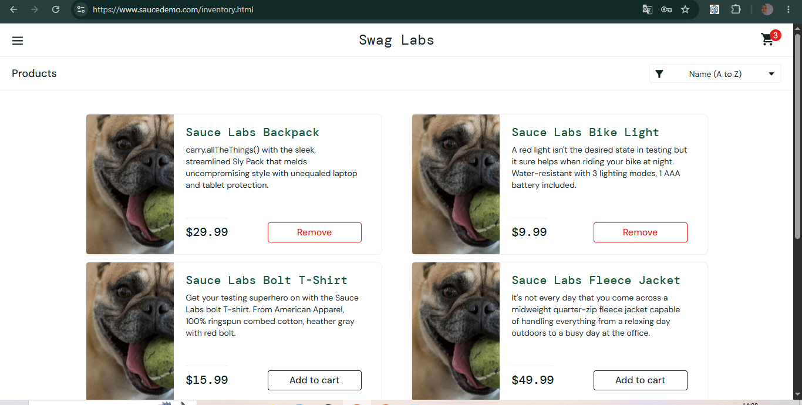
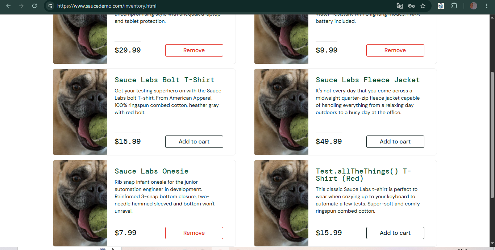

# BUG-003: Tombol "Add to cart" hanya berfungsi di 3 dari 6 produk

| Keterangan | Detail |
|---|---|
| Aplikasi | SauceDemo (saucedemo.com) |
| Akun | problem_user |
| Environment | Chrome 155, Windows 10 |
| Severity | High |
| Status | Open |

## Kondisi Awal
Data situs sudah dihapus. Setelah login, ikon keranjang tidak menunjukkan angka.

## Langkah Reproduksi
1. Buka saucedemo.com
2. Login sebagai problem_user (password: secret_sauce)
3. Di halaman Products, klik "Add to cart" pada setiap produk satu per satu

## Expected Result
Semua 6 produk bisa ditambahkan ke keranjang, tombol berubah menjadi "Remove", dan angka di ikon keranjang bertambah.

## Actual Result
Hanya 3 dari 6 produk yang berhasil ditambahkan. Tiga produk lainnya tidak merespons saat tombol diklik.

**Berfungsi:**
- Sauce Labs Backpack
- Sauce Labs Bike Light
- Sauce Labs Onesie

**Tidak berfungsi:**
- Sauce Labs Bolt T-Shirt
- Sauce Labs Fleece Jacket
- Test.allTheThings() T-Shirt (Red)

## Lampiran
**Bukti 1: setelah klik "Add to cart" pada keenam produk, Backpack dan Bike Light berubah menjadi "Remove", dan ikon keranjang menunjukkan angka 3**

**Bukti 2: pada produk lainnya, Bolt T-Shirt, Fleece Jacket, dan Test.allTheThings() T-Shirt (Red) tetap "Add to cart", sedangkan Onesie berubah menjadi "Remove"**

