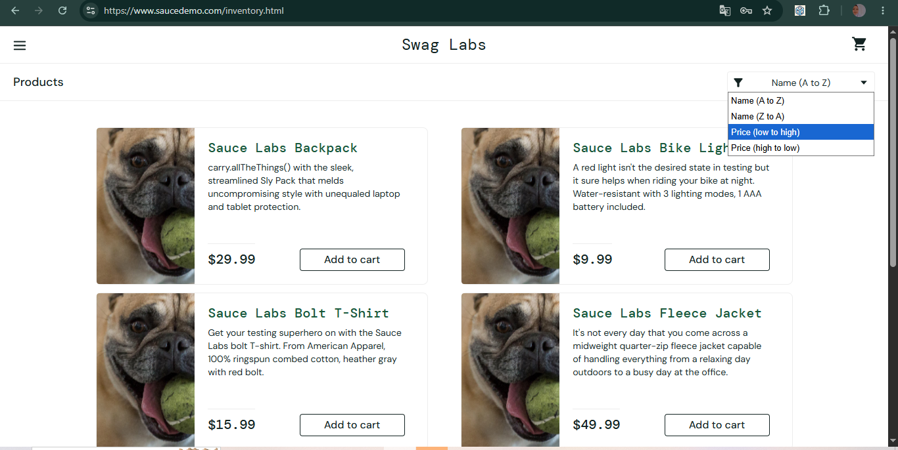
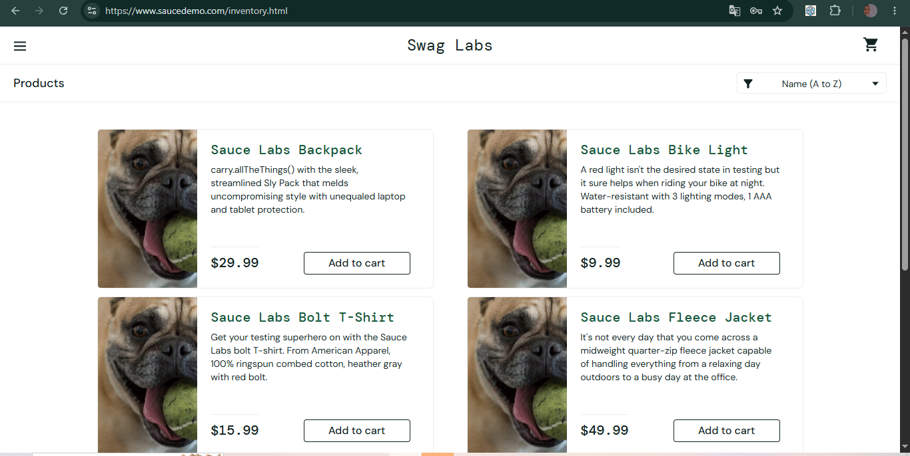
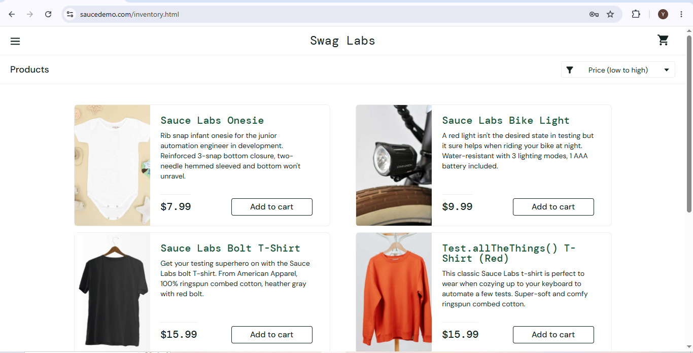

# BUG-004: Opsi sort selain Name (A to Z) tidak bisa dipilih

| Keterangan | Detail |
|---|---|
| Aplikasi | SauceDemo (saucedemo.com) |
| Akun | problem_user |
| Environment | Chrome 155, Windows 10 |
| Severity | Medium |
| Status | Open |

## Langkah Reproduksi
1. Buka saucedemo.com
2. Login sebagai problem_user (password: secret_sauce)
3. Klik dropdown sort di pojok kanan atas halaman Products
4. Pilih Name (Z to A), Price (low to high), atau Price (high to low)

## Expected Result
Dropdown menampilkan opsi yang dipilih dan produk terurut sesuai opsi tersebut.

## Actual Result
Setiap kali memilih opsi selain Name (A to Z), dropdown kembali menampilkan "Name (A to Z)" dan urutan produk tidak berubah. Hanya Name (A to Z) yang bisa aktif.

## Pembanding
Dengan akun standard_user, keempat opsi sort (Name A to Z, Name Z to A, Price low to high, Price high to low) berfungsi normal dan produk terurut sesuai pilihan.

## Lampiran
**problem_user, percobaan 1: setelah memilih Price (low to high), dropdown kembali ke Name (A to Z) dan urutan tidak berubah**

**problem_user, percobaan 2: setelah memilih Name (Z to A), dropdown kembali ke Name (A to Z) dan urutan tidak berubah**

**standard_user (pembanding): setelah memilih Price (low to high), produk terurut dari harga termurah**

