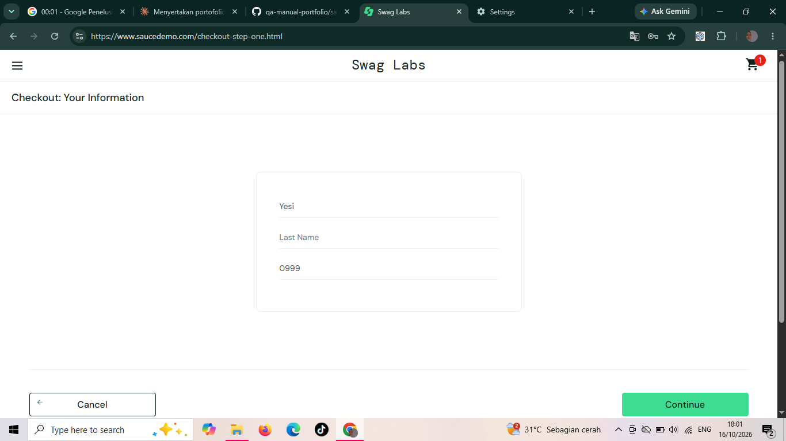
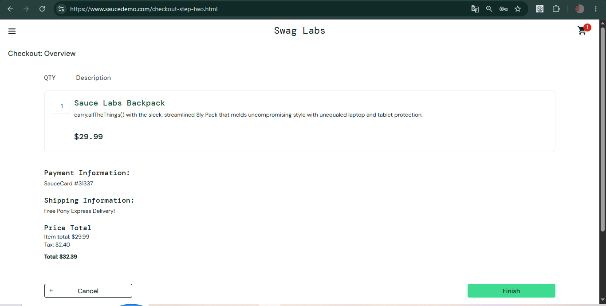
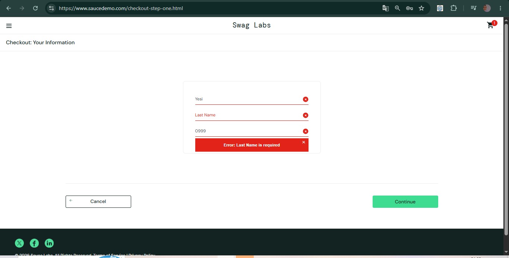

# BUG-005: Kolom Last Name tidak bisa diisi dan checkout tetap bisa dilanjutkan

| Keterangan | Detail |
|---|---|
| Aplikasi | SauceDemo (saucedemo.com) |
| Akun | error_user |
| Environment | Chrome 155, Windows 10 |
| Severity | High |
| Status | Open |

## Kondisi Awal
Data situs sudah dihapus. Satu produk sudah ada di keranjang.

## Langkah Reproduksi
1. Buka saucedemo.com
2. Login sebagai error_user (password: secret_sauce)
3. Tambahkan satu produk ke keranjang, buka keranjang, lalu klik Checkout
4. Pada halaman "Your Information", isi First Name dan Postal Code
5. Coba ketik pada kolom Last Name
6. Klik Continue

## Expected Result
Kolom Last Name bisa diisi. Jika dikosongkan, sistem menolak dan menampilkan pesan bahwa Last Name wajib diisi.

## Actual Result
Kolom Last Name tidak menerima input (tetap kosong setelah diketik). Saat Continue diklik dengan Last Name kosong, sistem tetap melanjutkan ke halaman berikutnya tanpa pesan error.

## Pembanding
Dengan akun standard_user, kolom Last Name bisa diisi, dan jika dikosongkan muncul pesan bahwa Last Name wajib diisi.

## Lampiran
**error_user: kolom Last Name tetap kosong setelah diketik**

**error_user: halaman berikutnya tetap terbuka setelah Continue diklik dengan Last Name kosong**

**standard_user (pembanding): kolom Last Name bisa diisi**

