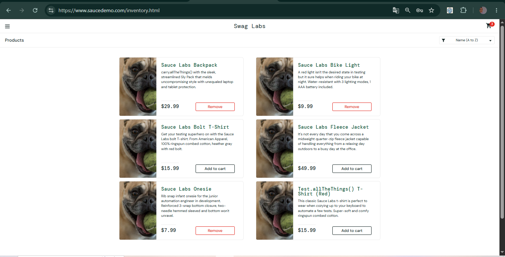

# BUG-007: Tombol "Remove" tidak berfungsi di halaman Products

| Keterangan | Detail |
|---|---|
| Aplikasi | SauceDemo (saucedemo.com) |
| Akun | problem_user |
| Environment | Chrome 155, Windows 10 |
| Severity | Medium |
| Status | Open |

## Kondisi Awal
Data situs sudah dihapus. Setelah login, ikon keranjang tidak menunjukkan angka.

## Langkah Reproduksi
1. Login sebagai problem_user (password: secret_sauce)
2. Di halaman Products, klik "Add to cart" pada Sauce Labs Backpack, Sauce Labs Bike Light, dan Sauce Labs Onesie (tombol berubah menjadi "Remove", badge menunjukkan 3)
3. Klik tombol "Remove" pada salah satu produk tersebut, misalnya Sauce Labs Backpack

## Expected Result
Produk keluar dari keranjang, tombol kembali menjadi "Add to cart", dan angka di ikon keranjang berkurang.

## Actual Result
Tombol "Remove" tidak merespons: tombol tetap "Remove" dan angka di ikon keranjang tetap 3.

## Lampiran
**Setelah tombol "Remove" pada Sauce Labs Backpack diklik, tombol tetap "Remove" dan badge tetap 3**

